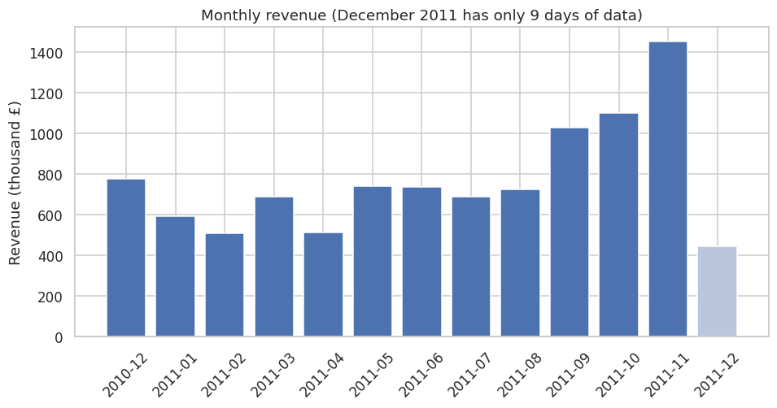
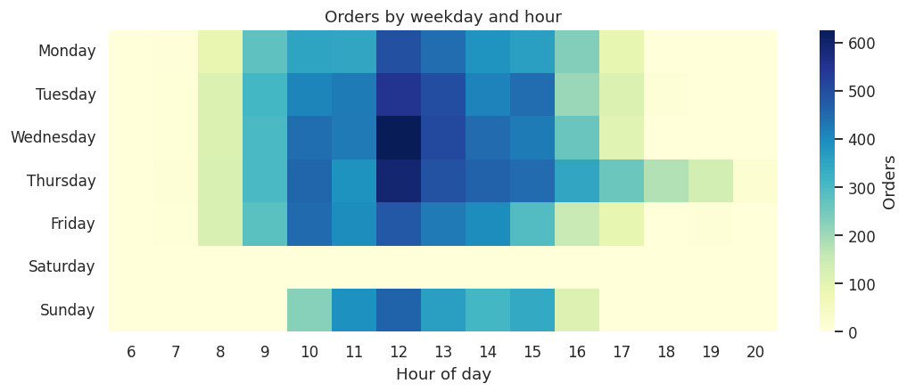
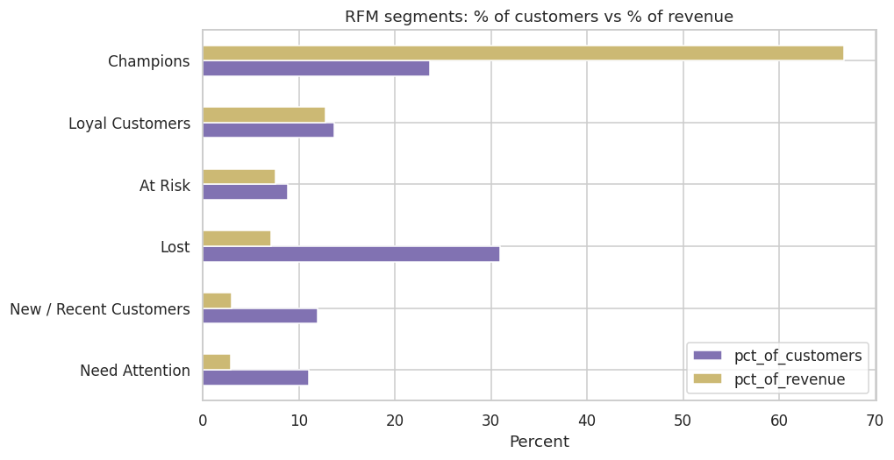
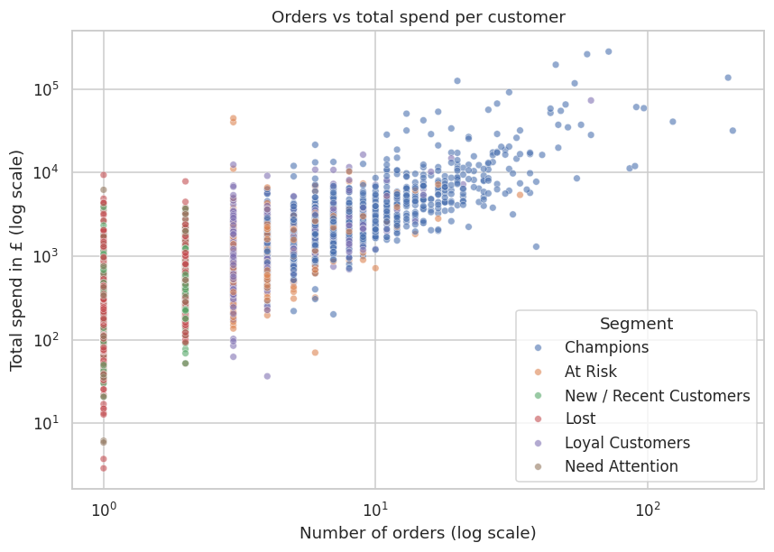
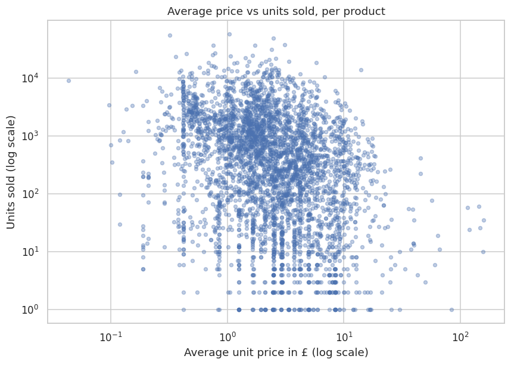
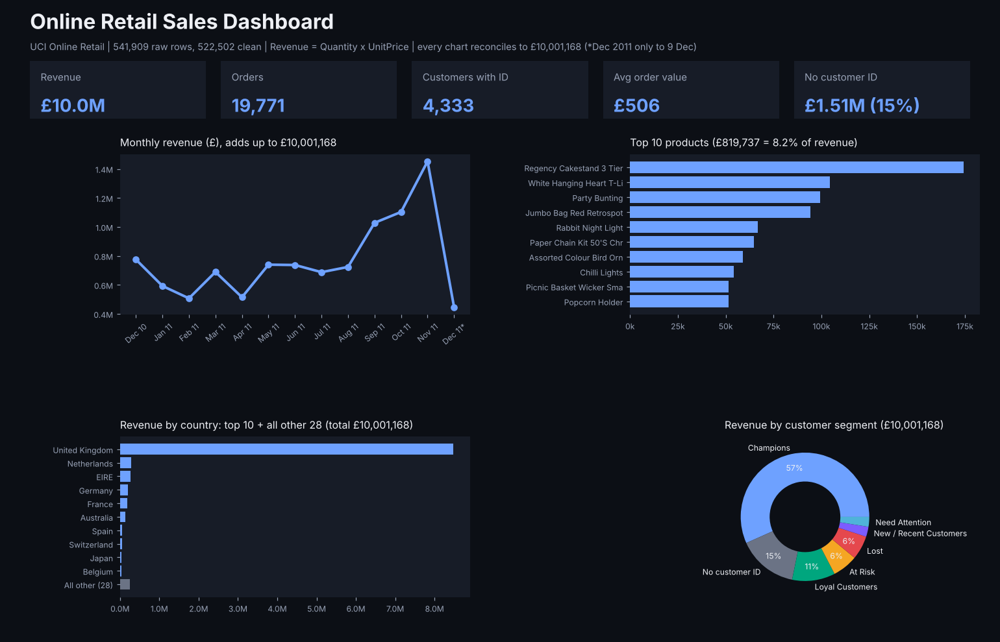

# Online Retail Sales Analysis

I analysed one year of sales from a UK online gift shop to find out when and where it earns money, how much it loses to returns, and which customers matter most. I used Python and SQL for the analysis.

**Tools:** Python (Pandas, NumPy, SciPy), SQL (SQLite), Matplotlib, Seaborn, Plotly

## Dataset
See `DATA.md` for how to get the raw file and `check_raw_data.py` to check you have the right one.

- UCI Machine Learning Repository, "Online Retail" dataset: https://archive.ics.uci.edu/dataset/352/online+retail (also available on Kaggle)
- 541,909 rows and 8 columns: invoice number, stock code, description, quantity, invoice date, unit price, customer ID, country
- Period: 1 Dec 2010 to 9 Dec 2011. Most customers are businesses buying gifts in bulk.
- The raw file is 46 MB, so it is not in this repo. Download it from the link above, save it as `OnlineRetail.csv` next to the notebook and run the notebook.

## Questions I tried to answer
1. How do sales change over the year, and when is the shop busiest?
2. Which products and countries bring in the most money?
3. How much money is lost to cancellations and returns?
4. Who are the best customers, and how much does the shop depend on them?

## What I did
1. **Checked data quality with SQL.** Counted missing values, duplicates, negative quantities and non-product codes in the raw table.
2. **Cleaned the data in Pandas** and logged every step (rows before and after). 522,502 of 541,909 rows (96%) were kept for sales analysis.
3. **Answered business questions with SQL** (CTEs, window functions such as `LAG`, `RANK` and running totals).
4. **Scored customers with RFM** (recency, frequency, monetary) in Python and grouped them into 6 segments using the Recency and Frequency scores. Monetary is shown as spend per segment.
5. **Made charts** including three scatter plots, and two interactive Plotly charts.

### Cleaning decisions
| Step | Rows affected |
|---|---|
| Exact duplicate rows removed | 5,268 |
| Cancellations (invoice starts with "C") moved to a separate returns table | 9,251 |
| Non-product codes removed (postage, fees, vouchers, adjustments) | 2,406 |
| Zero or negative quantity or price removed | 2,480 |
| 2 huge orders (80,995 and 74,215 units) that were cancelled within minutes removed | 2 |

Other decisions:
- Dates in the file are day first, so I parsed them with `dayfirst=True`.
- Rows with no `CustomerID` (25% of rows, 15% of revenue) are kept for sales, product and country analysis, but left out of the customer analysis.

## Key findings
- **Sales:** about £10.00 million from 19,771 orders after cleaning. Average order is about £506.
- **Seasonality:** September to November 2011 brought £3.58 million, which is 38% of the 12 full months of revenue. November 2011 was the best month (£1.45 million).
- **December 2011 is not a drop.** The data ends on 9 December. Per trading day it made about £55,752, almost the same as November (£55,850).
- **Timing:** most orders come between 12:00 and 15:00. Thursday is the busiest day and there are no orders on Saturdays.
- **Products:** the top product is REGENCY CAKESTAND 3 TIER (£174,157). The top 10 products are only 8% of revenue, so sales are spread over many products.
- **Countries:** the UK is 85% of revenue. Netherlands is the biggest market outside the UK.
- **Customers:** the top 20% of customers bring 74% of the revenue from known customers. 35% bought only once.
- **Returns:** cancellations are about 2.3% of sales value, and about 15% of invoices are cancellations.

### RFM scores and segments

Each customer gets a Recency, Frequency and Monetary score from 1 to 5. **The segment rules use only Recency and Frequency.** Monetary is scored too but is not used in the rules; it is reported as spend per segment. Frequency and spend are strongly related in this data (Spearman correlation 0.81), and Champions spend about £5,542 on average against £448 for Lost customers. So this is an RF-based segmentation with spend reported. In the table, "% of revenue" means the share of the £8.49M that comes from customers with an ID.

| Segment | Customers | % of customers | % of revenue |
|---|---|---|---|
| Champions | 1,023 | 23.6% | 66.8% |
| Loyal Customers | 591 | 13.6% | 12.8% |
| At Risk | 384 | 8.9% | 7.5% |
| Lost | 1,340 | 30.9% | 7.1% |
| New / Recent Customers | 517 | 11.9% | 3.0% |
| Need Attention | 478 | 11.0% | 2.9% |

Champions are 24% of customers but give 67% of revenue. The At Risk group bought often before but has stopped, so it is the best group to contact first.

## Charts

More charts are in the `charts` folder. The two `.html` files are interactive Plotly charts: download and open them in a browser.

## Limits of this analysis
- One year of data only, so I cannot say whether the autumn rise repeats every year.
- 25% of sale lines have no customer ID, so customer numbers cover known customers only.
- The shop sells mostly to businesses, so results may not apply to a normal consumer shop.
- Currency is not stated in the file. I show pounds because the shop is UK based.

## Files
- `online_retail_analysis.ipynb`: full analysis with all outputs
- `analysis.sql`: all SQL queries
- `charts/`: chart images and interactive charts
- `outputs/online_retail_sample.csv`: 5,000 row sample of the cleaned data
- `outputs/rfm_customers.csv`: RFM scores and segment for each customer
- `outputs/segment_summary.csv`, `outputs/cleaning_log.csv`: summary tables

## How to run
1. Download the dataset (link above) and save it as `OnlineRetail.csv` in the same folder as the notebook.
2. `pip install -r requirements.txt`
3. Open `online_retail_analysis.ipynb` in Jupyter or Google Colab and run all cells.

## Dashboard

How to read the numbers: total revenue after cleaning is £10,001,168. The segment chart splits it into customers with an ID (£8,491,574, 4,333 customers) and rows with no customer ID (£1,509,593, 15%). The country chart shows the top 10 countries and all the rest together. The top 10 products are 8.2% of revenue.
